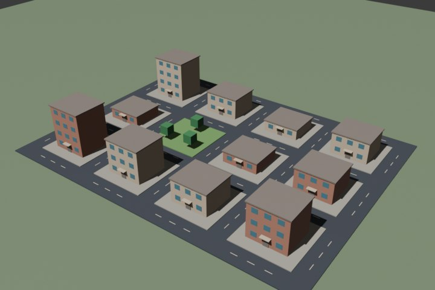

# AETHER ile Blender

Masaüstü AETHER'ı Blender kurulu bilgisayarda başlat. Eklenti Blender'ı PATH'te,
Windows'ta standart Blender Foundation klasöründe veya macOS'ta Applications
altında arar. Sahne planlama ve soru yanıtlama AETHER'ın ayarlı modelini kullanır.

| Örnek komut | Sonuç |
| --- | --- |
| “Blender'da metal ayaklı ahşap masa yap. Kamerayı önden yerleştir ve üstten aydınlat.” | Yeni bir sahne oluşturur. |
| “Son Blender projesinde masanın etrafına dört tabure ekle.” | Kayıtlı sahneyi okuyup yeni bir sürüm oluşturur. |
| “Blender projesinde hangi nesneler var?” | Nesne sayısını, etkin kamerayı ve ilk 20 ismi bildirir. |
| “Blender'da masayı 1. kareden 90. kareye kadar döndür.” | Nesnenin dönüşüne anahtar kareler ekleyebilir. |
| “Blender projemi aç / render al / GLB olarak dışa aktar.” | İlgili işlemi yapar ve dosya yolunu bildirir. |
| “Blender'da UV unwrap nasıl yapılır?” | Kurulu Blender'ın operatör bilgilerini kullanarak adımları açıklar. |
| “Blender işleminin durumu ne?” | Sonucu veya devam eden işlemin durumunu bildirir. |

Kendi dosyanı düzenlemek için önce Blender'da kaydet ve AETHER'a tam
`.blend` yolunu ver. İşlemler ayrı bir Blender sürecinde yürür. Yeni sürümler
kullanıcı klasöründeki `AETHER/Blender` altında oluşur. “Son proje” en son
başarıyla kaydedilip yeniden açılarak doğrulanan sahnedir. Render, sahnenin
geçerli karesini PNG olarak kaydeder.

Uygulama araçları arasında özel mesh, metin, kopyalama, yüzey malzemeleri,
bevel, subdivision, solidify, mirror, array, boolean, UV açma, kemik ve
ağırlık grupları, poz ve nesne animasyonu, kamera ve ışık, shader ve Geometry Nodes ağları bulunur. Bilgi alma
daha geniş konuları kapsar. Örneğin sıvı simülasyonu ve elle sculpt fırça darbeleri bu sürümün uygulama araçlarının dışındadır.

## Daha büyük sahneler

“Üç sıra ve dört sütunlu bir mahalle yap. İkinci sıranın ikinci parseli park
olsun, binalar en çok beş katlı olsun. Gündüz ışığında yukarıdan göster.”
Her parsel ayrı bir nesne olur. “İkinci sıranın üçüncü binasını kırmızı yap”
gibi devam komutlarıyla proje değiştirilebilir. Mahalle aracı bina dışlarını
ve yolları oluşturur. İç mekân için odaları, duvar boylarını, kapı ve pencere
yerlerini ayrıca tarif et.

“Seramik bir vazo yap, dar bir boynu ve geniş bir gövdesi olsun” gibi
tasarımlar için dönel yüzey, boru ve kablolar için düzenlenebilir eğri,
engebeli peyzaj için tohum değerinden tekrar üretilebilen arazi kullanılabilir.
Kumaş, çarpışma yüzeyi ve aktif/pasif katı cisim ayarları proje dosyasına
kaydedilir. Simülasyonu görmek için Blender'da zaman çizelgesini baştan oynat.

Karmaşık tariflerde planlayıcı işi 2–8 aşamaya ayırabilir. Her aşama bir
önceki kaydı açıp nesneleri okuyarak devam eder. Aşamalardan biri
tamamlanamazsa son başarılı proje seçili kalır. “Zaman çizelgesini animasyon
olarak render al” komutu her kareyi ayrı bir PNG olarak kaydeder.

Windows'ta AETHER, çalışan Blender veya Blender Launcher işleminin klasöründeki
`blender.exe` dosyasını da bulabilir. Özel bir kurulumu elle seçmek için
`AETHER_BLENDER_EXE` ortam değişkenine dosyanın tam yolunu verip AETHER'ı yeniden
başlatabilirsin. “Mahalleyi oluştur, projeyi ve renderi aç” isteği kaydedilen
projeyi Blender'da açar ve PNG çıktısını AETHER'ta gösterir.

Yazılı sahne isteğini doğrudan Blender aracına göndermek için örneğin
“Gazimağusa esintili, 11 binalı ve bir parklı sahil mahallesi oluştur. Projeyi ve renderi aç”
yazabilirsin. Özel tariflerde `/blender` öneki de aynı aracı çağırır.
Otomatik bulma başarısızsa eklenti ayarlarında Blender bölümüne tam
`blender.exe` yolunu kaydet ve komutu tekrarla.
